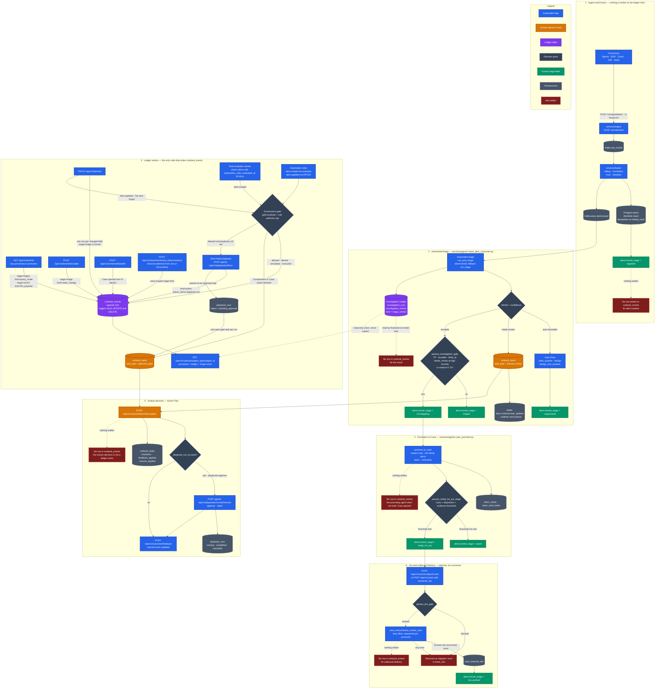
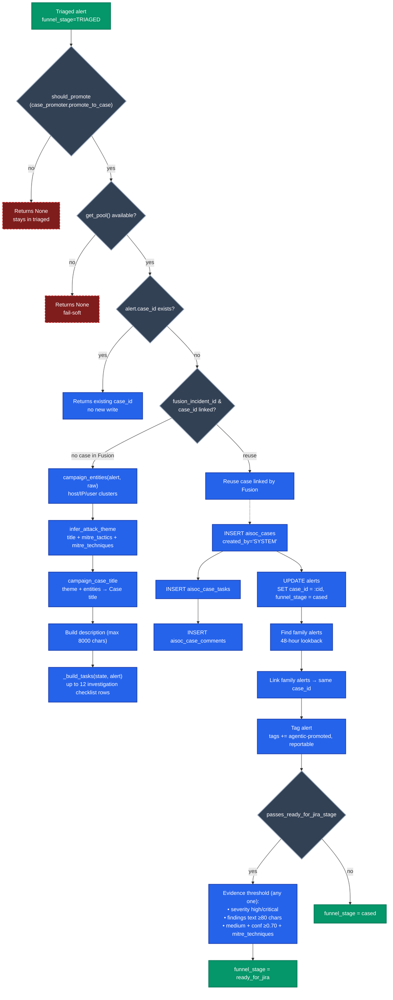
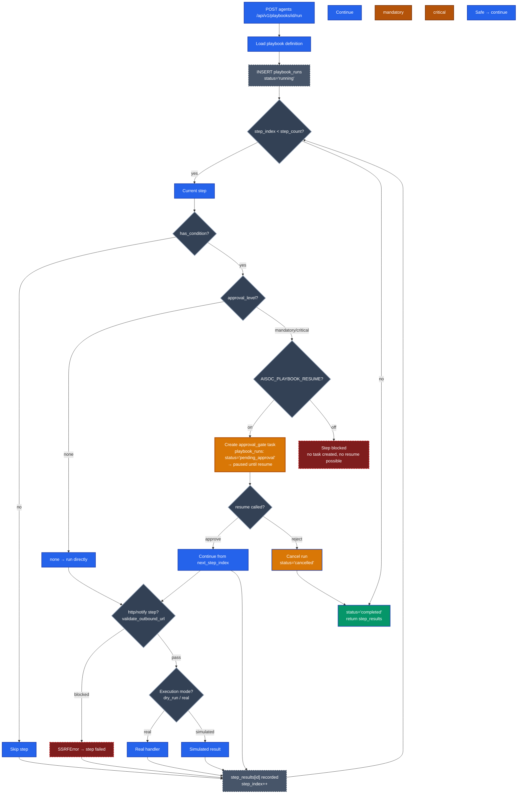
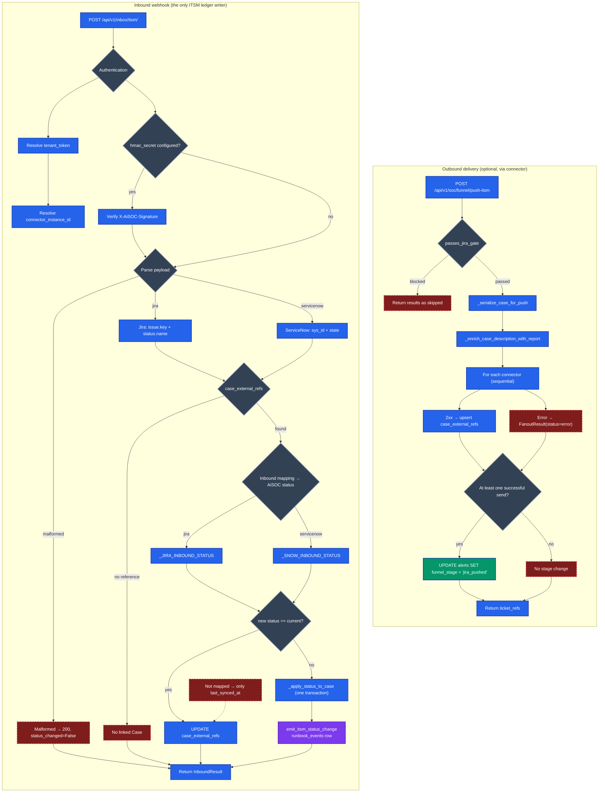
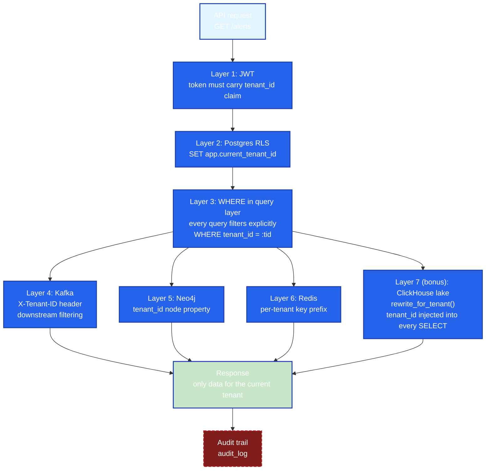
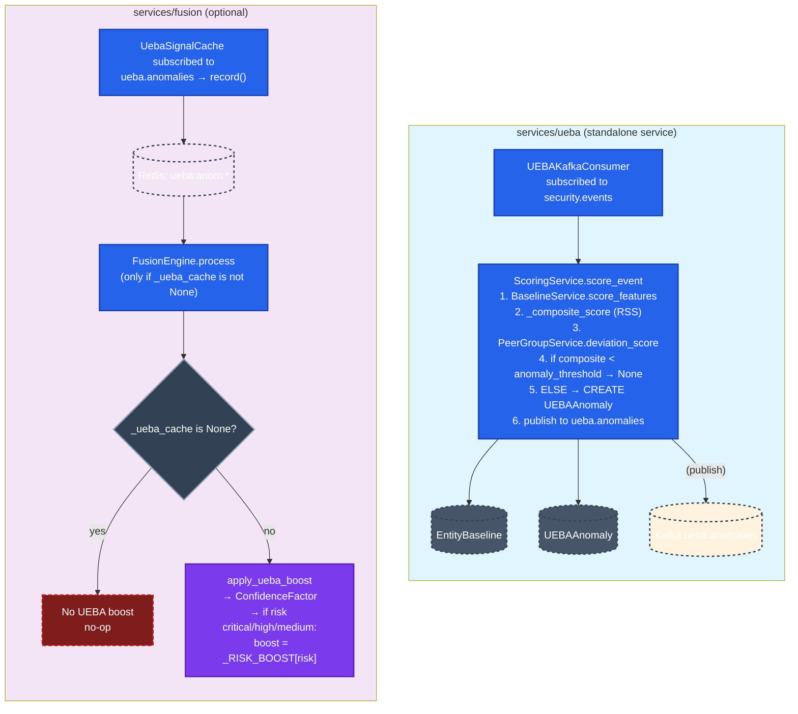

---

# معماری جامع و تاییدشده — AiSOC

**وضعیت:** تاییدشده بر اساس کد (Code-verified) در تاریخ ۲۰۲۶-۱۰-۳۰. هر فلش در نمودارهای زیر قابل ردیابی به یک فایل و یک تابع در سورس کد است. مراحلی که در پیاده‌سازی **وجود ندارند** با رنگ قرمز (`absent`) مشخص شده‌اند تا از توهمات معماری جلوگیری شود.

**این سند چیست:** منبع واحد حقیقت (Single Source of Truth) برای کل معماری پلتفرم. این سند شامل نمودار کلی چرخه حیات و سپس زوم عمیق روی هر زیرسیستم است.

---

## بخش ۱ — چرخه حیات اصلی (تاییدشده بر اساس کد)

این نمودار فازهای ۱ تا ۶ (از دریافت داده تا ارسال به Jira) را پوشش می‌دهد. فلش‌های ممتد مسیرهای کدی هستند که اجرا می‌شوند. فلش‌های نقطه‌چین با برچسب "نوشته نمی‌شود" نشان می‌دهند که در آن مرحله، هیچ رکوردی در دفتر ثبت (`runbook_events`) درج نمی‌شود.

---

## بخش ۲ — زیرسیستم‌های عمیق و تاییدشده

### ۲.۱ خط لوله تفصیلی Fusion

*   **UEBA Boost واقعی است اما اختیاری.** اگر کش Redis وجود داشته باشد، بسته به سطح ریسک یک افزایش (Additive) اعمال می‌کند.
*   **Vuln Boost واقعی و وابسته به کانفیگ است.**
*   **Neo4j یک مخزن هشدار نیست.** Fusion فقط در جدول `alerts` در Postgres می‌نویسد. گراف Neo4j توسط یک مسیر جداگانه در زمان Ingest نوشته می‌شود.

```mermaid
%%{init: {"theme": "default", "htmlLabels": false, "themeVariables": {"background": "#f1f5f9", "fontFamily": "Consolas, 'Courier New', monospace", "fontSize": "15px", "clusterBkg": "#e2e8f0", "clusterBorder": "#94a3b8", "edgeLabelBackground": "#ffffff"}, "flowchart": {"htmlLabels": false, "useMaxWidth": true, "padding": 24, "nodeSpacing": 40, "rankSpacing": 56, "wrappingWidth": 600, "curve": "basis"}}}%%
flowchart TD
    classDef auto     fill:#2563eb,stroke:#1e40af,stroke-width:2px,color:#fff
    classDef infra    fill:#475569,stroke:#334155,stroke-width:2px,color:#fff,stroke-dasharray:4 4
    classDef absent   fill:#7f1d1d,stroke:#b91c1c,stroke-width:2px,color:#fff,stroke-dasharray:6 3
    classDef decision fill:#334155,stroke:#94a3b8,stroke-width:2px,color:#fff
    classDef boost    fill:#7c3aed,stroke:#5b21b6,stroke-width:2px,color:#fff
    classDef narr     fill:#059669,stroke:#047857,stroke-width:2px,color:#fff

    INPUT[("Kafka raw_events<br/>normalized OCSF alert")]:::infra
    DEDUP["Deduplicator<br/>Redis SET NX + fingerprint<br/>duplicate? → early return"]:::auto
    DEDUP_DUP["Duplicate<br/>no further processing"]:::absent
    CORR["Correlator<br/>Redis + durable store<br/>time-window grouping"]:::auto
    ML["MLScorer<br/>IsolationForest anomaly_score<br/>LightGBM priority_score"]:::auto
    ENRICH["AlertEnricher<br/>extract IOCs → POST /enrich/bulk<br/>fill fused.enrichments"]:::auto
    ENRICH_SKIP["No IOCs → skipped<br/>scorer keeps 'no TI match'"]:::absent
    CONF["ConfidenceScorer<br/>7 weighted factors + memory change<br/>HIGH≥0.70 / MEDIUM / LOW &lt;0.40"]:::auto
    VULN{"vuln_boost_enabled?"}:::decision
    VULN_ON["VulnBoost<br/>exploited vulnerability found?<br/>exploit_in_wild = True<br/>trust +0.15"]:::boost
    VULN_OFF["Skipped"]:::absent
    UEBA_CACHE{"_ueba_cache available?"}:::decision
    UEBA_LOOKUP["UebaSignalCache.lookup<br/>highest anomaly in<br/>username / hostname / srcIP / dstIP"]:::auto
    UEBA_BOOST["apply_ueba_boost<br/>trust change +0.0–0.20<br/>anomaly_score raised to ≥ UEBA score"]:::boost
    UEBA_OFF["Skipped — no behavioral merge"]:::absent
    RBA{"_entity_risk enabled?"}:::decision
    RBA_ON["EntityRiskEngine.observe<br/>collect score per entity"]:::auto
    RBA_OFF["Skipped"]:::absent
    NARR["build_narrative<br/>deterministic, light Markdown<br/>summary / reason / correlation / action"]:::narr
    SINK["AlertSink.persist<br/>asyncpg INSERT … WHERE NOT EXISTS dedup_hash<br/>INSERTED / DUPLICATE / UNAVAILABLE / FAILED"]:::auto
    PG[("Postgres alerts")]:::infra
    TOP[("Kafka aisoc.alerts.fused")]:::infra
    N_NEO4J["Neo4j 'Incident Store'<br/>not written here"]:::absent

    INPUT --> DEDUP
    DEDUP -->|"duplicate"| DEDUP_DUP
    DEDUP -->|"unique"| CORR --> ML
    ML --> ENRICH
    ENRICH -->|"has IOCs"| ENRICH_SKIP -.->|"no-op enriches"| CONF
    ENRICH -->|"no IOCs"| CONF
    CONF --> VULN
    VULN -->|"yes"| VULN_ON -.->|"does not write Neo4j"| N_NEO4J
    VULN -->|"no"| UEBA_CACHE
    VULN_ON --> UEBA_CACHE
    UEBA_CACHE -->|"cache available"| UEBA_LOOKUP --> UEBA_BOOST
    UEBA_CACHE -->|"no (no cache / miss)"| UEBA_OFF -.->|"no-op"| RBA
    RBA --> NARR --> SINK
    SINK --> PG
    SINK --> TOP

    style INPUT fill:#475569,color:#fff
    style PG fill:#475569,color:#fff
    style TOP fill:#475569,color:#fff
    style DEDUP_DUP fill:#7f1d1d,color:#fff
    style ENRICH_SKIP fill:#7f1d1d,color:#fff
    style VULN_OFF fill:#7f1d1d,color:#fff
    style UEBA_OFF fill:#7f1d1d,color:#fff
    style RBA_OFF fill:#7f1d1d,color:#fff
    style N_NEO4J fill:#7f1d1d,color:#fff
```

---

### ۲.۲ درخت تصمیم‌گیری تریاژ خودکار

*   **Business context یک موتور قوانین کدی است، نه یک خواندن از Redis.**
*   **Memory و override دو مرحله جداگانه هستند.**
*   **تصمیم Cost governor انتخاب‌کننده لایه (Tier) است.**
*   **آستانه بستن خودکار `AISOC_AUTO_CLOSE_THRESHOLD` (پیش‌فرض 0.85) است.**

```mermaid
%%{init: {"theme": "default", "htmlLabels": false, "themeVariables": {"background": "#f1f5f9", "fontFamily": "Consolas, 'Courier New', monospace", "fontSize": "15px", "clusterBkg": "#e2e8f0", "clusterBorder": "#94a3b8", "edgeLabelBackground": "#ffffff"}, "flowchart": {"htmlLabels": false, "useMaxWidth": true, "padding": 24, "nodeSpacing": 40, "rankSpacing": 56, "wrappingWidth": 600, "curve": "basis"}}}%%
flowchart TD
    classDef auto     fill:#2563eb,stroke:#1e40af,stroke-width:2px,color:#fff
    classDef human    fill:#d97706,stroke:#b45309,stroke-width:3px,color:#fff
    classDef infra    fill:#475569,stroke:#334155,stroke-width:2px,color:#fff,stroke-dasharray:4 4
    classDef absent   fill:#7f1d1d,stroke:#b91c1c,stroke-width:2px,color:#fff,stroke-dasharray:6 3
    classDef decision fill:#334155,stroke:#94a3b8,stroke-width:2px,color:#fff
    classDef ledger   fill:#7c3aed,stroke:#5b21b6,stroke-width:2px,color:#fff
    classDef stage    fill:#059669,stroke:#047857,stroke-width:2px,color:#fff

    TOP[("Kafka aisoc.alerts.fused")]:::infra
    BC["BusinessContextApplier.apply<br/>phase B4 — rules file + environment flag<br/>suppress: drop (no triage cost)"]:::auto
    BC_SUPP["suppressed<br/>record_business_context_suppression<br/>disposition=benign, funnel_stage=suppressed"]:::auto
    ENRICH["_enrich_asset_context<br/>Asset/CMDB fail-soft<br/>add asset_context to raw_alert"]:::auto
    MEM_SUPP{"AISOC_AGENT_MEMORY_SUPPRESSION?"}:::decision
    MEM_LOOKUP["lookup_prior(signature)<br/>valid benign/FP history?"]:::auto
    MEM_RESOLVE["Auto-resolved from memory<br/>result from history, confidence 0.9<br/>tier=memory"]:::auto
    OVERRIDE_SUPP{"override enabled?"}:::decision
    OVERRIDE_LOOKUP["lookup_human_override<br/>coarse signature match?"]:::auto
    OVERRIDE_RESOLVE["Auto-resolved from analyst override<br/>verdict=corrected_verdict<br/>confidence 0.95<br/>tier=override"]:::auto
    GOVERNOR["get_governor().check<br/>evidence fingerprint → Decision"]:::auto
    TIER{"Tier selection"}:::decision
    TIER_CACHED["DEDUPLICATED + cached result<br/>reuse result, no LLM"]:::auto
    TIER_DETR["Deterministic<br/>run_triage(state)"]:::auto
    TIER_LLM["run_auto_triage(state)<br/>LLM, with tenant BYOK override<br/>falls back to deterministic on error"]:::auto
    VERDICT["state.verdict + state.confidence<br/>guarded: empty verdict → needs_review"]:::auto
    PERSIST["persist_auto_triage<br/>one transaction:<br/>investigation_runs<br/>investigation_events<br/>alerts: disposition, ai_score, funnel_stage"]:::ledger
    NEEDS_REVIEW{"verdict == needs_review?"}:::decision
    TASK["create_task_for_needs_review<br/>runbook_tasks (task_type=manual_review)<br/>Kafka aisoc.runbook.task_updates"]:::human
    COMPLETED{"state.status is COMPLETED?"}:::decision
    INV_GATE["passes_investigation_gate<br/>TP/escalate/likely_tp → yes<br/>needs_review at high severity → yes"]:::decision
    SET_INV["_set_funnel_stage<br/>UPDATE alerts SET funnel_stage=investigating"]:::auto
    ESCALATE["_maybe_escalate<br/>run_escalation(state)"]:::auto
    PROMOTE["_maybe_promote_case<br/>case_promoter.promote_to_case"]:::auto
    AUTO_CLOSE{"verdict in AUTO_CLOSEABLE?"}:::decision
    FP_TAG["tag_false_positive<br/>tags += false_positive<br/>funnel_stage=suppressed"]:::auto
    SUPPRESSED["funnel_stage = suppressed"]:::stage
    TRIAGED["funnel_stage = triaged"]:::stage
    INVESTIGATING["funnel_stage = investigating"]:::stage

    TOP --> BC
    BC -->|"suppressed"| BC_SUPP --> SUPPRESSED
    BC -->|"continue"| ENRICH
    ENRICH --> MEM_SUPP
    MEM_SUPP -->|"yes"| MEM_LOOKUP
    MEM_LOOKUP -->|"suppress"| MEM_RESOLVE --> SUPPRESSED
    MEM_LOOKUP -->|"no suppress"| OVERRIDE_SUPP
    MEM_SUPP -->|"no"| OVERRIDE_SUPP
    OVERRIDE_SUPP -->|"yes"| OVERRIDE_LOOKUP
    OVERRIDE_LOOKUP -->|"suppress"| OVERRIDE_RESOLVE --> SUPPRESSED
    OVERRIDE_LOOKUP -->|"no suppress"| GOVERNOR
    OVERRIDE_SUPP -->|"no"| GOVERNOR
    GOVERNOR --> TIER
    TIER -->|"DEDUPLICATED"| TIER_CACHED
    TIER -->|"deterministic"| TIER_DETR
    TIER -->|"LLM available"| TIER_LLM
    TIER_CACHED --> VERDICT
    TIER_DETR --> VERDICT
    TIER_LLM --> VERDICT
    VERDICT --> PERSIST
    PERSIST --> NEEDS_REVIEW
    NEEDS_REVIEW -->|"yes"| TASK
    NEEDS_REVIEW -->|"no"| COMPLETED
    TASK --> COMPLETED
    COMPLETED -->|"yes (auto-closed)"| AUTO_CLOSE
    COMPLETED -->|"no"| INV_GATE
    AUTO_CLOSE -->|"yes"| FP_TAG --> SUPPRESSED
    AUTO_CLOSE -->|"no"| TRIAGED
    INV_GATE -->|"no"| TRIAGED
    INV_GATE -->|"yes"| SET_INV --> ESCALATE --> PROMOTE --> INVESTIGATING

    style TOP fill:#475569,color:#fff
    style BC_SUPP fill:#2563eb,color:#fff
    style MEM_RESOLVE fill:#2563eb,color:#fff
    style OVERRIDE_RESOLVE fill:#2563eb,color:#fff
    style TIER_CACHED fill:#2563eb,color:#fff
    style TIER_DETR fill:#2563eb,color:#fff
    style TIER_LLM fill:#2563eb,color:#fff
    style TASK fill:#d97706,color:#fff
    style FP_TAG fill:#2563eb,color:#fff
    style SUPPRESSED fill:#059669,color:#fff
    style TRIAGED fill:#059669,color:#fff
    style INVESTIGATING fill:#059669,color:#fff
```

---

### ۲.۳ تحقیق و ارتقا به Case

*   **جستجوی Case موجود با شباهت عنوان وجود ندارد.**
*   **پنجره ۴۸ ساعته فقط برای لینک کردن هم‌خانواده‌هاست.**
*   **آستانه شواهد برای ready_for_jira در کد ≥۸۰ کاراکتر است.**
*   **کد تا ۱۲ تسک پویا تولید می‌کند.**

---

### ۲.۴ اجرای پلی‌بوک و دروازه‌های تایید

*   **محافظ SSRF کامل است.**
*   **رفتار دروازه به `AISOC_PLAYBOOK_RESUME` بستگی دارد.**
*   **Resume از `next_step_index` ادامه می‌یابد.**
*   **جدول `playbook_approvals` فقط طرح‌واره است.**

---

### ۲.۵ یکپارچه‌سازی Jira و چرخه حیات تیکت

*   **همگام‌سازی دوره‌ای وجود ندارد.**
*   **ارسال خروجی ترتیبی است، نه موازی.**
*   **وب‌هوک ورودی تنها نویسنده دفتر ثبت ITSM است.**
*   **مراجع خارجی در `case_external_refs` هستند.**

---

### ۲.۶ معماری پایگاه داده و ذخیره‌سازی

*   جدول `triage_ledger` و `case_findings` وجود ندارند. جدول اصلی `runbook_events` است.
*   `playbook_approvals` فقط طرح‌واره است.
*   Neo4j توسط Fusion نوشته نمی‌شود.

```mermaid
%%{init: {"theme": "default", "htmlLabels": false, "themeVariables": {"background": "#f1f5f9", "fontFamily": "Consolas, 'Courier New', monospace", "fontSize": "15px", "clusterBkg": "#e2e8f0", "clusterBorder": "#94a3b8", "edgeLabelBackground": "#ffffff"}, "flowchart": {"htmlLabels": false, "useMaxWidth": true, "padding": 24, "nodeSpacing": 40, "rankSpacing": 56, "wrappingWidth": 600, "curve": "basis"}}}%%
flowchart LR
    classDef infra    fill:#475569,stroke:#334155,stroke-width:2px,color:#fff,stroke-dasharray:4 4
    classDef postgres fill:#2563eb,stroke:#1e40af,stroke-width:2px,color:#fff
    classDef kafka    fill:#d97706,stroke:#b45309,stroke-width:2px,color:#fff
    classDef redis    fill:#7c3aed,stroke:#5b21b6,stroke-width:2px,color:#fff
    classDef clickhouse fill:#059669,stroke:#047857,stroke-width:2px,color:#fff
    classDef neo4j    fill:#1d4ed8,stroke:#1e40af,stroke-width:2px,color:#fff
    classDef qdrant   fill:#0d9488,stroke:#0f766e,stroke-width:2px,color:#fff
    classDef absent   fill:#7f1d1d,stroke:#b91c1c,stroke-width:2px,color:#fff,stroke-dasharray:6 3

    subgraph PG["PostgreSQL (primary)"]
        direction TB
        ALERTS[("alerts<br/>id, tenant_id, title, description,<br/>severity, status, priority,<br/>mitre_tactics, mitre_techniques, iocs,<br/>entities, raw_event, dedup_hash,<br/>confidence, confidence_label,<br/>confidence_rationale, narrative,<br/>anomaly_score, event_time, first_seen,<br/>last_seen, created_at, updated_at,<br/>ai_recommendations, tags,<br/>enrichment_data, affected_ips,<br/>affected_users, affected_assets,<br/>child_alert_ids, is_merged,<br/>connector_id, connector_type,<br/>source_event_ids, ocsf_class_uid,<br/>rule_id, rule_name, affected_hosts,<br/>llm_payload, funnel_stage,<br/>automation_rules_evaluated_at,<br/>case_id, disposition, ai_summary, ai_score")]:::postgres
        CASES[("aisoc_cases<br/>id, tenant_id, case_number, title,<br/>description, severity, status,<br/>assignee, tags, mitre_techniques,<br/>mitre_tactics, created_by,<br/>created_at, updated_at,<br/>triaged_at, resolved_at, closed_at,<br/>observable_graph, evidence_chain,<br/>case_type, external_ticket_url,<br/>external_ticket_id, external_status")]:::postgres
        CASE_TASKS[("aisoc_case_tasks<br/>id, case_id, title, description,<br/>status, order_index,<br/>created_at, completed_at,<br/>completed_by, notes")]:::postgres
        RUNBOOK_EVENTS[("runbook_events<br/>id, tenant_id, subject_type,<br/>subject_id, seq, occurred_at,<br/>stage, kind, action_name,<br/>actor_type, actor_id, actor_label,<br/>summary, detail, status, policy,<br/>approval_id, run_id, input, output,<br/>cost, error, duration_ms,<br/>audit_log_id, idempotency_key,<br/>created_at<br/>— append-only")]:::postgres
        RUNBOOK_TASKS[("runbook_tasks<br/>id, tenant_id, alert_id, task_type,<br/>title, description, status,<br/>created_by, created_at,<br/>assigned_to, assigned_at,<br/>completed_at, completed_by,<br/>resolution, feedback_applied,<br/>resume_applied, playbook_run_id,<br/>signature, gate_id")]:::postgres
        PLAYBOOK_RUNS[("playbook_runs<br/>id, playbook_id, tenant_id,<br/>status, trigger, trigger_meta,<br/>started_at, completed_at,<br/>step_index, next_step_index,<br/>gate_step_id, gate_step_name,<br/>error, summary, created_by,<br/>approval_decision, approved_by,<br/>rejected_by")]:::postgres
        PLAYBOOK_STEP_RESULTS[("playbook_step_results<br/>id, run_id, step_id, step_index,<br/>status, output, error,<br/>duration_ms, created_at")]:::postgres
        PLAYBOOK_APPROVALS[("playbook_approvals<br/>— schema only (migration 072)<br/>no writer, no reader")]:::absent
        CASE_EXTERNAL_REFS[("case_external_refs<br/>id, case_id, connector_instance_id,<br/>vendor, external_id, external_url,<br/>external_status, pushed_by,<br/>last_synced_at, created_at, updated_at")]:::postgres
        TENANT_INBOX_TOKENS[("tenant_inbox_tokens<br/>id, tenant_id, token, template_id,<br/>hmac_secret, last_used_at,<br/>created_at, revoked_at")]:::postgres
        AUTOMATION_RULES[("automation_rules<br/>id, tenant_id, rule_name,<br/>rule_type, trigger_type,<br/>condition, action, action_type,<br/>action_config, autonomy_level,<br/>dry_run, description,<br/>required_connector_type,<br/>created_at, updated_at,<br/>enabled, installed_from_pack")]:::postgres
        CONNECTORS[("connectors<br/>id, tenant_id, name, connector_type,<br/>connector_config, auth_config,<br/>is_enabled, poll_interval_seconds,<br/>last_poll_at, next_poll_at,<br/>fusion_persist_failed,<br/>created_at, updated_at")]:::postgres
        USERS[("users<br/>id, tenant_id, email, name,<br/>role, created_at, updated_at")]:::postgres
        AUDIT_LOG[("audit_log<br/>id, tenant_id, actor_type, actor_id,<br/>action, resource_type, resource_id,<br/>before, after, occurred_at,<br/>source_ip, user_agent")]:::postgres
    end

    subgraph KAFKA["Kafka (Redpanda-compatible)"]
        TOPIC1[("raw_events")]:::kafka
        TOPIC2[("aisoc.alerts.fused")]:::kafka
        TOPIC3[("aisoc.runbook.task_updates")]:::kafka
        TOPIC4[("ueba.anomalies")]:::kafka
        DLQ[("aisoc.alerts.fused.dlq")]:::kafka
    end

    subgraph REDIS["Redis"]
        R1[("aisoc:fusion:correlation:*")]:::redis
        R2[("aisoc:fusion:incident:*")]:::redis
        R3[("ueba:anom:*")]:::redis
        R4[("cost_governor:*")]:::redis
        R5[("memory:*")]:::redis
    end

    subgraph CLICKHOUSE["ClickHouse (event lake)"]
        CH1[("aisoc.raw_events")]:::clickhouse
        CH2[("aisoc.alert_metrics")]:::clickhouse
        CH3[("aisoc.ioc_enrichments")]:::clickhouse
    end

    subgraph NEO4J["Neo4j (entity graph)"]
        NG[("User / Asset / Process / IP / Domain /<br/>Alert nodes")]:::neo4j
    end

    subgraph QDRANT["Qdrant (vector store)"]
        QD[("IOC embeddings + actor profiles")]:::qdrant
    end

    style PG fill:#e1f5ff
    style KAFKA fill:#fff3e0
    style REDIS fill:#f3e5f5
    style CLICKHOUSE fill:#e0f2f1
    style NEO4J fill:#fff9c4
    style QDRANT fill:#ffccbc
```

---

### ۲.۷ لایه‌های جداسازی مستاجر (Tenant Isolation)

*   **"پارتیشن‌بندی Kafka با tenant_id" دقیق نیست.**
*   **جداسازی دریاچه ClickHouse یک لایه هفتم است.**
*   **کلیدهای Redis ساده‌سازی شده‌اند.**

---

### ۲.۸ یکپارچه‌سازی UEBA

*   **"UEBA Boost: 1.15×" اشتباه است.** افزایشی و وابسته به ریسک است.
*   **آستانه Z-score > 1.5σ اشتباه است.** آستانه ترکیبی RSS برابر `anomaly_threshold` (پیش‌فرض ۳.۰).
*   **UEBA در Fusion اختیاری است.**
*   **سرویس UEBA مستقل است.**

---

## بخش ۳ — ماتریس "بدون نوشتن" (No-Write Matrix)

| نقطه در چرخه حیات | چرا ردیفی نیست | مرجع کد |
|---|---|---|
| دریافت خام، ادغام، ساخت هشدار | Ingest مسیر داغ (hot path) است؛ sink ادغام فقط در `alerts` می‌نویسد. | `services/fusion/app/services/alert_sink.py` |
| Claim هشدار توسط ارزیاب قوانین | Claim یک عملیات DB روی `alerts` است. نوشتن‌های دفتر ثبت *پس از* claim رخ می‌دهند. | `services/api/app/workers/rule_evaluator.py` |
| نتیجه تریاژ خودکار | متعلق به `investigation_events` است؛ Runbook آن را بازمی‌خواند تا کپی نکند. | `services/agents/app/investigator/ledger.py` |
| بستن خودکار / کاهش FP | یک تگ روی ردیف هشدار (`false_positive`). | `services/agents/app/workers/case_promoter.py` |
| سرکوب زمینه تجاری | `disposition=benign`، `funnel_stage=suppressed` را تنظیم می‌کند. | `services/agents/app/workers/case_promoter.py` |
| انتقال‌های مرحله فانل | `alerts.funnel_stage` منبع حقیقت است. | `services/api/app/services/funnel_stages.py` |
| ارتقا به Case توسط ایجنت (`case_promoter`) | `aisoc_cases` / تسک‌ها / کامنت‌ها را می‌نویسد، بدون نویسنده Runbook. | `services/agents/app/workers/case_promoter.py` |
| ساخت Case از طریق `POST /api/v1/cases` | هیچ emitter در آن مسیر فراخوانی نمی‌شود. | `services/api/app/api/v1/endpoints/cases.py` |
| ساخت Case توسط لینک حادثه Fusion | از Case موجود استفاده مجدد می‌کند. | `services/agents/app/workers/case_promoter.py` |
| تکمیل تسک Runbook (هر نوع) | در `runbook_tasks` نوشته می‌شود. | `services/api/app/api/v1/endpoints/runbook.py` |
| ارسال خروجی Jira / ServiceNow | دفتر ثبت پاسخ فروشنده را ثبت می‌کند، نه درخواست ما را. | `services/api/app/services/case_fanout.py` |
| عملیات انبوه فانل | در سطح مستاجر → `audit_log`، نه `runbook_events`. | `services/api/app/services/agentic_funnel.py` |
| اجرای گام پلی‌بوک | در `playbook_step_results` و `playbook_runs` ذخیره می‌شود. | `services/agents/app/playbook/engine.py` |
| تکمیل / لغو پلی‌بوک | در `playbook_runs.status` ذخیره می‌شود. | `services/agents/app/playbook/engine.py` |
| تایید/رد انسان در دروازه پلی‌بوک | در `runbook_tasks.resolution` + `resume_applied` ذخیره می‌شود. | `services/api/app/api/v1/endpoints/runbook.py` |
| سرکوب حافظه / سرکوب override | `investigation_runs` + `investigation_events` را می‌نویسد، اما بدون `runbook_events`. | `services/agents/app/workers/fused_alert_consumer.py` |
| همگام‌سازی دوره‌ای وضعیت Jira/ServiceNow | وجود ندارد — وضعیت فقط از طریق وب‌هوک وارد می‌شود. | (تایید شده که غایب است) |
| جستجوی Case با شباهت عنوان | وجود ندارد — فقط `case_id` و لینک حادثه بررسی می‌شود. | `services/agents/app/workers/case_promoter.py` |
| نوشتن در جدول `playbook_approvals` | فقط طرح‌واره. بدون نویسنده، بدون خواننده. | `services/agents/app/models/playbook_approval.py` |
| نوشتن هشدار در Neo4j از Fusion | Neo4j توسط نویسنده گراف جداگانه در زمان Ingest نوشته می‌شود. | `services/fusion/app/services/alert_sink.py` |

---

## ضمیمه — تایید شده بر اساس

- `services/fusion/app/services/fusion_engine.py`
- `services/fusion/app/services/alert_sink.py`
- `services/fusion/app/services/confidence.py`
- `services/fusion/app/services/vuln_boost.py`
- `services/fusion/app/services/ueba_signal.py`
- `services/fusion/app/services/alert_enricher.py`
- `services/fusion/app/services/correlator.py`
- `services/fusion/app/services/narrative.py`
- `services/agents/app/workers/fused_alert_consumer.py`
- `services/agents/app/funnel/stages.py`
- `services/agents/app/workers/case_promoter.py`
- `services/agents/app/investigator/ledger.py`
- `services/agents/app/playbook/engine.py`
- `services/agents/app/playbook/ssrf_guard.py`
- `services/agents/app/playbook/approvals.py`
- `services/agents/app/playbook/resume.py`
- `services/api/app/workers/rule_evaluator.py`
- `services/api/app/services/runbook/rule_executor.py`
- `services/api/app/services/runbook/recorder.py`
- `services/api/app/services/runbook/emitters.py`
- `services/api/app/services/funnel_stages.py`
- `services/api/app/services/case_fanout.py`
- `services/api/app/api/v1/endpoints/inbox_itsm.py`
- `services/api/app/db/rls.py`
- `services/api/app/services/lake_sql.py`
- `services/ueba/app/services/scoring.py`
- `services/ueba/app/services/baseline.py`
- `services/ueba/app/services/kafka_consumer.py`
- `services/ueba/app/core/config.py`
- Migrations: 062, 064, 065, 066, 067, 068, 069, 070, 072, 073.